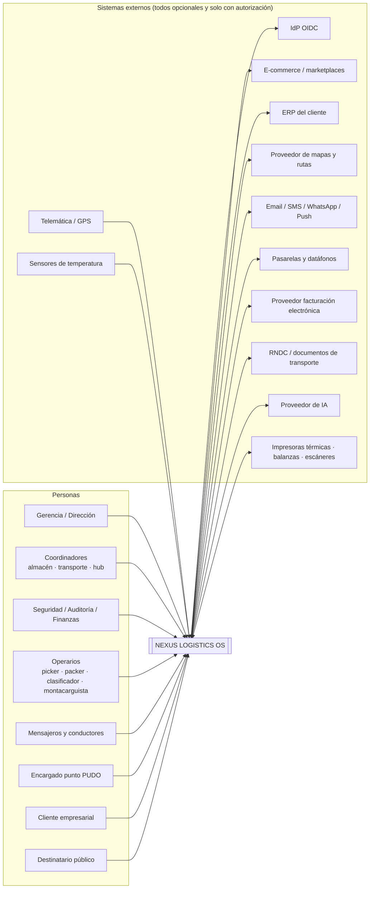
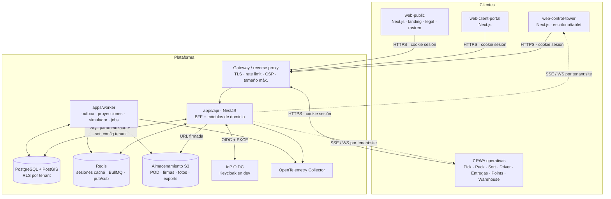
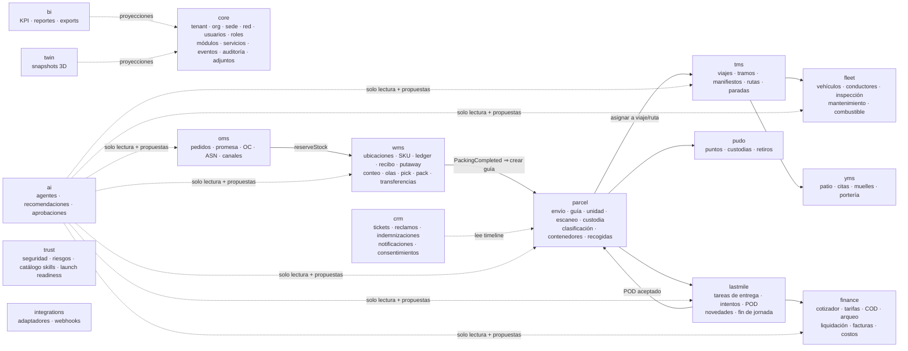

# Arquitectura técnica — NEXUS LOGISTICS OS V2.0

> **Estado:** diseño (Etapa 0). Nada de lo descrito aquí está implementado todavía. Las decisiones se justifican en los [ADR](adr/README.md).
> **Precedencia aplicada:** Apéndices L–Q > Apéndice K (pantalla inicial) > Apéndices J, I, D–E > secciones 01–30.

## 1. Vista de contexto (C4 nivel 1)



**Ninguna integración externa existe al inicio.** Cada conector se implementa como adaptador con estado `desconectado | configurando | conectado | degradado | error` (sección 22.3). Mientras no haya credenciales autorizadas, opera un *mock* rotulado. **No hay integración con Coordinadora Mercantil S. A.** (`L.2`, `P.03`).

## 2. Vista de contenedores (C4 nivel 2)



| Contenedor | Responsabilidad | Escala |
|---|---|---|
| `web-control-tower` | Command Center, módulos de escritorio, Nexus Control, 3D, IA, Seguridad, Configuración | Horizontal, sin estado |
| `web-client-portal` | Cotizar, guías, recogidas, stock contractual, facturas, reportes del cliente | Horizontal |
| `web-public` | Landing, legal, consentimientos, rastreo público con token | Horizontal + CDN |
| PWA operativas | Tareas por rol, escaneo, POD, offline | Estático + CDN |
| `apps/api` | Autenticación BFF, autorización, casos de uso, API `/v1`, SSE/WS | Horizontal, sin estado (sesión en Redis/PG) |
| `apps/worker` | Publicación outbox, consumidores, proyecciones, importaciones, notificaciones, simulador, reportes | Horizontal por cola |
| PostgreSQL | Fuente de verdad transaccional + eventos | Primario + réplica de lectura para BI (Hito 10) |
| Redis | Caché, colas, *rate limit*, pub/sub de tiempo real. **No es fuente de verdad** | Single → Sentinel/Cluster |
| S3 | Binarios privados | Gestionado |

## 3. Módulos de dominio (C4 nivel 3, dentro de `apps/api`)



Las flechas sólidas son **llamadas síncronas por fachada** dentro de la misma transacción ([ADR-0001](adr/ADR-0001-monolito-modular.md)). Las punteadas son **lecturas de proyecciones o eventos**.

### 3.1 Propiedad de la verdad (`O.01`)

| Dominio | Dueño de | Lo consumen |
|---|---|---|
| OMS | Pedido, líneas, promesa comercial | WMS, Parcel, CRM, Finance |
| WMS | Existencias (ledger/saldo), ubicaciones, tareas de almacén | OMS, Pack, 3D, BI |
| Parcel | Envío, guía, unidad física, custodia, estado de red | TMS, Last Mile, CRM, BI |
| TMS | Viaje, tramo, ruta, parada, capacidad asignada | Parcel, Fleet, BI |
| YMS | Visita de patio, cita, ocupación de muelle | TMS, WMS, 3D |
| Fleet | Vehículo, conductor, documentos, mantenimiento | TMS, YMS |
| Last Mile | Tarea de entrega, intento, POD, liquidación de reparto | Parcel, CRM, Finance |
| PUDO | Custodia en punto, retiro | Parcel, CRM |
| Finance | Cotización, tarifa, COD, arqueo, liquidación, factura | CRM, BI |
| CRM | Ticket, reclamo, comunicación, consentimiento | BI |
| AI | Recomendación y aprobación. **Nunca la verdad operativa** | Todos, con permisos |
| BI / Twin | Proyecciones. **Nunca escriben** stock ni guías | UI |

## 4. Capas internas de cada módulo

```text
modules/<dominio>/
├── api/            # Controllers REST /v1, DTO = esquemas Zod de shared-contracts
├── application/    # Casos de uso (1 clase = 1 comando), orquestan transacción + eventos
├── domain/         # Entidades, máquinas de estado, invariantes (reexporta domain-core)
├── infrastructure/ # Repositorios Prisma/SQL, adaptadores
├── policies/       # Reglas ABAC específicas del dominio
├── projections/    # Consumidores de eventos (corren en worker)
└── index.ts        # Fachada pública: único punto importable desde otros módulos
```

**Pipeline de un comando mutante** (todo en servidor):

```mermaid
sequenceDiagram
  participant C as Cliente (web/PWA)
  participant G as Gateway
  participant A as API (guard + caso de uso)
  participant P as PostgreSQL
  participant W as Worker
  C->>G: POST /v1/... (cookie, CSRF, Idempotency-Key)
  G->>A: rate limit OK, tamaño OK
  A->>A: autenticar sesión → membership → tenant/site
  A->>A: validar esquema Zod (422 si falla)
  A->>A: ABAC: permiso + atributos (403 / 404)
  A->>P: BEGIN; set_config(app.tenant_id…)
  A->>P: idempotency_record (si existe → devolver resultado previo)
  A->>P: cargar agregado (version) → transición válida? (409)
  A->>P: escribir agregado + domain_event + outbox_event + audit_entry
  A->>P: COMMIT
  A-->>C: 200/201 + recurso + version
  W->>P: outbox FOR UPDATE SKIP LOCKED
  W->>W: proyecciones (KPI, timeline, 3D), notificaciones, IA
  W-->>C: SSE/WS: cambio en canal tenant:site
```

Errores estandarizados (`O.05`): `401` sin sesión, `403` sin permiso sobre un recurso visible, `404` recurso inexistente **o de otro tenant**, `409` conflicto de versión/estado/idempotencia con cuerpo distinto, `422` validación, `423` bloqueado por política (p. ej. COD congelado), `429` *rate limit*. Cuerpo: `{ code, message_es, details?, correlation_id }`, sin trazas, SQL ni datos de otro tenant.

## 5. Flujos de negocio de referencia

### 5.1 Orquestación multioperación (`L.5`)

`ProcessTemplate` (en `core`) define por `ServiceOffering` los pasos obligatorios y opcionales:

| Plantilla | Pasos | Caso de prueba |
|---|---|---|
| `FULFILLMENT_ECOMMERCE` | OMS → reserva WMS → pick → pack → guía Parcel → hub → troncal → hub destino → ruta → POD → liquidación | U02 |
| `PARCEL_PREPARED` | Guía → recogida o admisión → hub → troncal → ruta → POD (sin SKU ni inventario) | U04 |
| `B2B_PALLET_CROSSDOCK` | ASN → cita de muelle → recibo → cross-dock (sin ledger comercial) → manifiesto TMS → recibo en destino | U03 |
| `B2B_PALLET_STORAGE` | ASN → recibo → putaway → … → despacho de estibas → TMS | U01 + U03 |
| `DOCUMENT_SIGN_RETURN` | Guía de documento → entrega con firma → retorno del documento firmado | — |
| `RETURN_TO_SENDER` | Novedad → nueva custodia → tramo inverso → recepción en origen → decisión | U20 |
| `RMA_ECOMMERCE` | RMA → recogida → inspección → `return_to_stock` / `repair` / `dispose` … | U20 |

### 5.2 Cadena de custodia

Toda transferencia física de una unidad crea un `custody_handover` con `from_party`, `to_party`, sede, dispositivo, hora del dispositivo y del servidor, y evidencia. **Invariante:** una `parcel_unit` tiene exactamente **un custodio actual** (`parcel.parcel_unit.current_custodian_*`), y un índice único impide que dos mensajeros la tengan a la vez (`M.12`).

## 6. Seguridad (resumen; detalle en `docs/security/` a partir del Hito 1)

| Control | Implementación | Referencia |
|---|---|---|
| Aislamiento de tenant | `tenant_id` en sesión + RLS forzado + claves de caché/S3/canales con prefijo | [ADR-0004](adr/ADR-0004-multitenancy-rls.md) |
| Sesión | OIDC + PKCE, BFF, cookie `__Host-` HttpOnly, CSRF, revocación inmediata | [ADR-0005](adr/ADR-0005-identidad-sesiones.md) |
| Autorización | RBAC + ABAC en guard, worker y WS; BOLA → 404 | [MAPA_ROLES](../product/MAPA_ROLES.md) |
| Integridad | Eventos y auditoría *append-only* con cadena de hash por entidad sensible | [ADR-0006](adr/ADR-0006-eventos-outbox.md) |
| Idempotencia | `Idempotency-Key` obligatoria en comandos de creación, pago, escaneo, POD y sync | `O.05` |
| IA | Sin herramientas de escritura; aprobación humana + revalidación en servidor; *kill switch* | [ADR-0009](adr/ADR-0009-ia-gobernada.md) |
| Cabeceras | CSP estricta con *nonce*, HSTS, `X-Content-Type-Options`, `Referrer-Policy`, `Permissions-Policy` (cámara/geo solo en PWA) | `D.4` |
| SSRF | *Allowlist* de dominios para integraciones; bloqueo de IP privadas y metadatos | `D.4` |
| Archivos | MIME y tamaño validados, nombre aleatorio, URL firmada de corta duración, escaneo de malware (Hito 10) | `D.3` |
| Secretos | Nunca en el repositorio; `.env.example` sin valores; Gitleaks en CI | `D.6` |
| Cadena de suministro | *Lockfile*, Renovate, SCA, SBOM CycloneDX, acciones fijadas por SHA | `D.6` |
| Privacidad | Minimización por rol, enmascaramiento de teléfonos y direcciones, retención por categoría, Ley 1581 | `D.9`, `P.02.C` |

**Límites de confianza:** (1) navegador/PWA ↔ gateway; (2) API ↔ base de datos (rol sin BYPASSRLS); (3) API ↔ proveedor de IA (datos minimizados); (4) API ↔ integraciones (entradas no confiables, validadas); (5) dispositivo offline ↔ sync (operaciones firmadas y revalidadas).

## 7. Observabilidad y resiliencia

- **Trazas**: `trace_id` W3C propagado desde el cliente → API → outbox (`traceparent` guardado en el evento) → worker → notificación.
- **Métricas**: latencia p50/p95 por endpoint, lag del outbox, tamaño de DLQ, sincronizaciones offline pendientes por dispositivo, tasa de `deny` de autorización, consumo de IA por tenant, fps del 3D (RUM).
- **Health checks**: `/health/live` y `/health/ready` (PG, Redis, S3, IdP).
- **Degradación** (`26.3`):
  - **Si cae la IA:** el motor de reglas toma el relevo y aparece el *banner* «IA en modo degradado». Las operaciones siguen (U31).
  - **Si cae el mapa:** se muestra «Mapa no disponible» con la lista de paradas en tabla. No se crean rutas ficticias.
  - **Si falla el 3D:** se activa el plano 2D.
  - **Si falla Redis:** el tiempo real se degrada a *polling*. Las colas se acumulan en el outbox de PostgreSQL y nada se pierde.
- **Backups**: PITR de PostgreSQL más restauración ensayada y documentada (Hito 10). Los objetivos RTO/RPO se definen tras el análisis de impacto, sin cifras arbitrarias (`D.8`).

## 8. Entornos

| Entorno | Datos | Notas |
|---|---|---|
| `development` | Seed DEMO local | Docker Compose |
| `test` | Fixtures efímeros (Testcontainers) | CI |
| `staging` | DEMO + datos sintéticos de carga | DAST autorizado (OWASP ZAP) |
| `production` | Reales | Requiere revisión legal y de seguridad previa (`P.02.F`) |

## 9. Convenciones transversales

- **IDs**: UUIDv7 (ordenables por tiempo). Los códigos legibles (guía, pedido, viaje) son únicos por tenant y se generan con secuencias por tenant y prefijo configurable.
- **Tiempo**: `timestamptz` siempre en UTC. Se presenta en `America/Bogota` o en la zona de la sede. Los KPI declaran su zona horaria.
- **Dinero**: `numeric(18,2)` + `currency char(3)` (COP por defecto). Nunca `float`.
- **Medidas**: kg, cm, m³ y km en el sistema internacional; la conversión ocurre solo en la presentación (el escenario `SF-48291` usa millas).
- **Idioma**: `es-CO` por defecto, con i18n preparado (claves en `packages/design-system/i18n`).
- **Campos transversales** (`O.02`): `id`, `tenant_id`, `client_account_id?`, `site_id?`, `created_at`, `updated_at`, `created_by`, `version`, `status`, `source`, `correlation_id`, `external_reference?`, `deleted_at` solo donde se permita *soft-delete*.

## 10. Riesgos de arquitectura

| ID | Riesgo | Mitigación | Estado |
|---|---|---|---|
| AR-01 | El alcance total (16 capas, 7 PWA, 50 casos E2E) excede cualquier iteración única | Vertical slices por hito ([PLAN_HITOS](../product/PLAN_HITOS.md)); cada hito se cierra con pruebas | Abierto |
| AR-02 | Prisma no cubre RLS ni bloqueos | SQL parametrizado documentado + test de cobertura RLS | Mitigado en diseño |
| AR-03 | Almacenamiento offline desalojado en iOS | `storage.persist()`, sync frecuente y aviso al operario | Mitigado en diseño |
| AR-04 | Crecimiento de `domain_event` | Particionado mensual + archivo | Mitigado en diseño |
| AR-05 | Normativa (Ley 1369, RNDC, DIAN, Ley 1581) mal interpretada | Motor de elegibilidad por servicio + revisión legal antes de producción | Abierto (requiere asesor) |
| AR-06 | Catálogo de skills inaccesible desde la sesión de desarrollo | Hito 9 depende de acceso de red al repositorio externo | Bloqueado hasta Hito 9 |
| AR-07 | Apéndice H (98 requisitos de videos) aún sin clasificar | Clasificación en el [registro de requisitos](../product/REGISTRO_REQUISITOS.md) durante el Hito 1 | Abierto |
