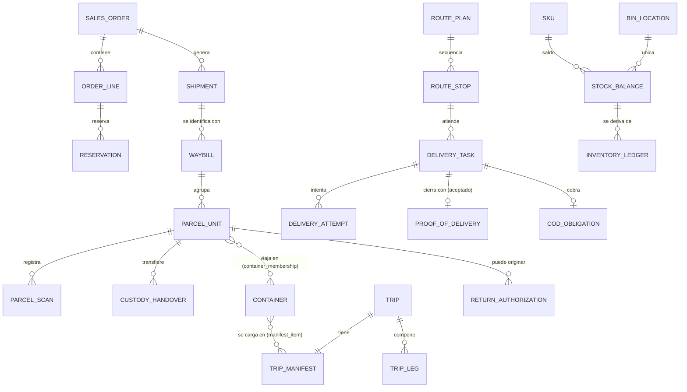

# Esquema de base de datos — NEXUS LOGISTICS OS V2.0

> **Estado:** diseño lógico (Etapa 0). Se convierte en `database/prisma/schema.prisma` + migraciones SQL (RLS, `CHECK`, triggers) en cada hito, **solo para las tablas del vertical slice en curso**.
> Motor: PostgreSQL + PostGIS. Fuente: `O.02`, `L.6`, `20.1`, `20.2`, `O.03`.

## 1. Convenciones

| Regla | Detalle |
|---|---|
| Esquemas | Uno por módulo de dominio: `core`, `oms`, `wms`, `parcel`, `tms`, `yms`, `fleet`, `lastmile`, `pudo`, `finance`, `crm`, `ai`, `bi`, `security`. |
| PK | `id uuid` (UUIDv7) en todas las tablas. |
| Tenant | `tenant_id uuid NOT NULL` + RLS `ENABLE` + `FORCE` en **todas** las tablas de negocio ([ADR-0004](adr/ADR-0004-multitenancy-rls.md)). Excepción: catálogos globales de plataforma (`core.country`, `core.currency`, `security.skill_catalog_entry`), que no contienen PII ni datos de tenant. |
| Cliente contractual | `client_account_id uuid` en tablas con datos del cargador (pedidos, SKU, stock, guías, POD, facturas). Una política RLS adicional aplica a los usuarios de portal. |
| Columnas comunes | `created_at timestamptz NOT NULL DEFAULT now()`, `updated_at`, `created_by uuid`, `version int NOT NULL DEFAULT 1` (bloqueo optimista), `source text` (`api`/`device`/`simulator`/`integration`/`import`), `correlation_id uuid`. |
| Códigos legibles | `UNIQUE (tenant_id, code)`; nunca únicos globales. |
| Estados | `text` + `CHECK (status IN (...))`, generado desde la máquina de estados de `domain-core`. Las transiciones se validan en la aplicación y quedan en el evento. |
| Cantidades | `numeric(18,4)` + `uom`. `CHECK (quantity >= 0)` donde aplica. |
| Dinero | `numeric(18,2)` + `currency char(3)`. |
| Geo | `geography(Point, 4326)` + `accuracy_m numeric` + `geo_source text` + `captured_at`. |
| Borrado | Sin `ON DELETE CASCADE` en datos operativos. *Soft-delete* (`deleted_at`) solo en maestros (SKU, cliente, ubicación). Eventos, ledger, auditoría, POD, COD y custodia **no** se borran. |
| Append-only | `core.domain_event`, `core.audit_entry`, `wms.inventory_ledger`, `parcel.parcel_scan`, `parcel.custody_handover`, `lastmile.delivery_attempt`, `finance.collection_entry`: un *trigger* `prevent_update_delete()` lo hace cumplir y `nexus_app` solo tiene `INSERT, SELECT`. |
| Índices | Siempre empiezan por `tenant_id`. Índices parciales para unicidad condicionada (p. ej. un POD aceptado por tarea). |

## 2. Modelo de identidad física (`L.6`)



**Reglas clave:**
- `InventoryUnit` (saldo de SKU en ubicación) **≠** `ParcelUnit` (pieza física en tránsito). Un picking empacado genera `parcel_unit` con `package_id` de origen; el stock pasa a `shipped` en el ledger.
- Una orden genera N envíos; un envío tiene 1..N guías según la modalidad; una guía agrupa 1..N unidades; una unidad pasa por N tramos y N custodias.

## 3. Tablas por esquema

> Notación: **negrita** = clave natural o restricción relevante. Todas incluyen las columnas comunes de §1 aunque no se repitan.

### 3.1 `core` — identidad, red, configuración, eventos

| Tabla | Columnas principales | Restricciones / notas |
|---|---|---|
| `tenant` | `code`, `legal_name`, `nit`, `data_mode` (`demo`/`real`), `default_timezone`, `default_currency`, `status` | **`UNIQUE(code)`**; tabla raíz, no tiene `tenant_id` |
| `organization` | `tenant_id`, `name`, `kind` (`operator`/`subcontractor`) | |
| `business_unit` | `organization_id`, `name` | |
| `client_account` | `code`, `legal_name`, `id_type` (`NIT`/`CC`/…), `id_number`, `kind` (`natural`/`juridica`), `status`, `credit_terms` | **`UNIQUE(tenant_id, id_type, id_number)`** |
| `contract` | `client_account_id`, `valid_from`, `valid_to`, `modules_enabled[]`, `sla_profile_id` | `CHECK(valid_to IS NULL OR valid_to > valid_from)` |
| `service_type` | `code` (`DOC_EXPRESS`, `PARCEL_STD`, `PARCEL_EXPRESS`, `SAME_DAY`, `LTL`, `FTL`, `PALLET`, `COLD`, `HIGH_VALUE`, `FULFILLMENT`, `RETURN`, `DOC_SIGN_RETURN`), `regulatory_regime` (`postal_express`/`road_cargo`/`air_cargo`/`internal`) | `L.4`, `P.02` |
| `service_offering` | `service_type_id`, `name`, `max_weight_kg`, `max_dims_cm`, `volumetric_divisor`, `requires_pod_method[]`, `cod_allowed`, `max_attempts`, `pudo_allowed`, `process_template_id`, `source_note`, `effective_from` | Límites configurados **con fecha y fuente** (`L.4`) |
| `service_rule` | `service_offering_id`, `rule_kind` (`eligibility`/`restriction`/`document`/`evidence`), `expression jsonb` | Motor de elegibilidad (`P.02.E`) |
| `process_template` | `code`, `steps jsonb` (paso, obligatorio, condiciones) | `L.5` |
| `sla_profile` | `name`, `promise_rules jsonb`, `cutoff_rules jsonb`, `exclusions jsonb` | |
| `module_activation` | `scope_type` (`tenant`/`client_account`/`contract`/`site`), `scope_id`, `module`, `enabled` | **`UNIQUE(tenant_id, scope_type, scope_id, module)`** (`L.1`) |
| `site` | `code`, `name`, `kind` (`warehouse`/`hub`/`branch`/`store`/`terminal`/`pudo`/`yard`), `address_id`, `timezone`, `geo`, `calendar_id`, `capacity jsonb` | **`UNIQUE(tenant_id, code)`** |
| `work_zone` | `site_id`, `code`, `kind` (`receiving`/`storage`/`picking`/`packing`/`sorting`/`staging`/`dock`/`cold`/`quarantine`), `restricted` | |
| `physical_location` | `site_id`, `work_zone_id`, `code`, `kind`, `x,y,z,w,h,d` | Infraestructura compartida WMS/Parcel/YMS (`M.10`) |
| `network_link` | `origin_site_id`, `destination_site_id`, `mode` (`road`/`air`/`urban`), `schedule jsonb`, `max_capacity`, `cutoff_local`, `lead_time_min`, `carrier_id`, `priority`, `is_alternative` | `M.01` |
| `calendar` / `holiday` | `calendar_id`, `date`, `kind` | Festivos de Colombia como datos, no código |
| `shift` | `site_id`, `name`, `starts_at_local`, `ends_at_local`, `days[]` | |
| `shift_assignment` | `shift_id`, `user_id`, `date`, `status` (`scheduled`/`active`/`revoked`/`closed`) | `U35` |
| `address` | `line1`, `line2`, `city_code` (DANE), `department_code`, `postal_code`, `geo`, `geocode_quality`, `normalized jsonb` | PII → acceso por rol |
| `contact` | `full_name`, `phone_e164`, `email`, `id_type?`, `id_number?` | PII; enmascarado por defecto |
| `user` | `idp_subject`, `display_name`, `email`, `status`, `mfa_enrolled` | **`UNIQUE(idp_subject)`**; la tabla es de plataforma, el acceso por tenant va vía `membership` |
| `role` | `code`, `name`, `is_system` | Catálogo en [MAPA_ROLES](../product/MAPA_ROLES.md) |
| `permission` | `code` (`recurso:acción`) | |
| `role_permission` | `role_id`, `permission_id` | |
| `membership` | `user_id`, `tenant_id`, `role_id`, `scope jsonb` (`site_ids[]`, `client_account_ids[]`, `services[]`), `valid_from`, `valid_to`, `status` | **`UNIQUE(user_id, tenant_id, role_id)`** |
| `device` | `user_id?`, `kind` (`phone`/`scanner`/`tablet`/`printer`/`scale`), `fingerprint_hash`, `hmac_key_ref`, `status` (`active`/`revoked`/`wipe_pending`), `last_seen_at`, `clock_skew_ms` | `M.13` borrado remoto |
| `session` | `user_id`, `tenant_id`, `device_id?`, `created_at`, `last_seen_at`, `revoked_at`, `mfa_level` | Caché en Redis; verdad aquí |
| `domain_event` | Contrato de [ADR-0006](adr/ADR-0006-eventos-outbox.md) + `integrity_hash`, `prev_hash` | *Append-only*; particionada por mes; índice `(tenant_id, entity_type, entity_id, entity_version)` **único** |
| `outbox_event` | `domain_event_id`, `published_at?`, `attempts`, `next_attempt_at` | Índice parcial `WHERE published_at IS NULL` |
| `event_consumer_checkpoint` | `consumer`, `event_id`, `processed_at` | **`PK(consumer, event_id)`** |
| `dead_letter` | `consumer`, `event_id`, `error`, `attempts`, `resolved_at` | |
| `idempotency_record` | `scope` (endpoint), `key`, `request_hash`, `response_status`, `response_body`, `expires_at` | **`UNIQUE(tenant_id, scope, key)`**; un cuerpo distinto con la misma clave ⇒ `409` |
| `audit_entry` | `actor_id`, `actor_kind` (`user`/`agent`/`system`/`support`), `action`, `resource_type`, `resource_id`, `decision` (`allow`/`deny`), `reason`, `before_redacted jsonb`, `after_redacted jsonb`, `request_id`, `trace_id`, `ip_hash?`, `integrity_hash` | *Append-only* (`D.7`, `18.3`) |
| `attachment` | `owner_type`, `owner_id`, `storage_key`, `mime`, `size_bytes`, `sha256`, `classification` (`public`/`internal`/`pii`/`sensitive`), `retention_until`, `scan_status` | URL firmada por objeto (`D.3`) |
| `notification` | `recipient_kind`, `recipient_ref`, `channel`, `template_code`, `status`, `provider_ref` | |
| `integration_config` | `connector`, `status` (`disconnected`/`configuring`/`connected`/`degraded`/`error`), `secret_ref`, `last_sync_at`, `last_error` | Secretos fuera de la base (`secret_ref`) |
| `webhook_subscription` / `webhook_delivery` | `url`, `events[]`, `secret_ref` / `status`, `attempts`, `response_code` | *Allowlist* SSRF |
| `data_processing_record` | `purpose`, `legal_basis`, `categories[]`, `retention_days`, `processors[]` | Ley 1581 (`D.9`) |
| `consent_record` | `subject_ref`, `purpose`, `document_version`, `granted`, `channel`, `captured_at` | H-LEG-03 |

### 3.2 `oms` — pedidos y abastecimiento

| Tabla | Columnas principales | Restricciones / notas |
|---|---|---|
| `channel_integration` | `client_account_id`, `channel` (`manual`/`csv`/`api`/`shopify`/…), `status` | |
| `sales_order` | `client_account_id`, `code`, `channel`, **`external_order_id`**, `kind` (`b2c`/`b2b`/`wholesale`/`subscription`), `priority`, `ship_to_address_id`, `ship_to_contact_id`, `service_offering_id`, `promised_by`, `promise_source`, `status` (`NEW`/`VERIFIED`/`ALLOCATED`/`PICKING`/`PICKED`/`PACKING`/`PACKED`/`DISPATCHED`/`CLOSED`/`PARTIAL`/`RETURNED`/`CANCELLED`), `cod_amount?` | **`UNIQUE(tenant_id, channel, external_order_id)`** (`M.03`, `U39`) |
| `order_line` | `sales_order_id`, `sku_id`, `quantity`, `uom`, `lot_constraint?`, `substitution_allowed` | `CHECK(quantity > 0)` |
| `order_allocation` | `order_line_id`, `warehouse_site_id`, `quantity`, `status` | |
| `sla_promise` | `sales_order_id`, `promised_at`, `basis jsonb` (inventario, corte, cobertura, festivos), `version` | Promesa sin ETA inventada (`M.03`) |
| `supplier` | `code`, `legal_name`, `nit` | |
| `purchase_order` / `purchase_order_line` | `supplier_id`, `client_account_id`, `status` / `sku_id`, `quantity` | |
| `asn` | `purchase_order_id?`, `client_account_id`, `code`, `expected_at`, `dock_appointment_id?`, `status` (`announced`/`arrived`/`receiving`/`received`/`closed_with_discrepancy`) | |
| `asn_line` | `asn_id`, `sku_id`, `expected_qty`, `lot?`, `expiry?`, `handling_unit_ref?` | |

### 3.3 `wms` — almacén

| Tabla | Columnas principales | Restricciones / notas |
|---|---|---|
| `warehouse` | `site_id`, `storage_policy` | 1:1 con `core.site(kind=warehouse)` |
| `zone` / `aisle` / `rack` | `warehouse_id`, `code`, `kind`, `temp_min_c?`, `temp_max_c?`, `x,y,z,w,h,d` | Jerarquía `M.05` |
| `bin_location` | `rack_id`, `code` (p. ej. `CALI-A-02-03`), `level`, `position`, `max_weight_kg`, `max_volume_m3`, `allowed_categories[]`, `is_virtual`, `status` (`active`/`blocked`/`counting`) | **`UNIQUE(tenant_id, code)`** |
| `product_category` | `code`, `handling` (`fragile`/`cold`/`hazmat_blocked`/`high_value`) | |
| `sku` | `client_account_id`, `code`, `barcode[]`, `description`, `category_id`, `base_uom`, `weight_kg`, `dims_cm`, `lot_tracked`, `serial_tracked`, `expiry_tracked`, `rotation_rule` (`FIFO`/`FEFO`/`LIFO`), `abc_class` | **`UNIQUE(tenant_id, client_account_id, code)`** |
| `uom` / `uom_conversion` | `sku_id`, `from_uom`, `to_uom`, `factor` | |
| `lot` | `sku_id`, `code`, `expiry_date?`, `manufactured_at?`, `status` | **`UNIQUE(tenant_id, sku_id, code)`** |
| `serial` | `sku_id`, `code`, `lot_id?` | **`UNIQUE(tenant_id, sku_id, code)`** |
| `inventory_ledger` | `owner_client_account_id`, `sku_id`, `lot_id?`, `serial_id?`, `from_bin_id?`, `to_bin_id?`, `from_status?`, `to_status?`, `quantity`, `uom`, `reason_code`, `reference_type`, `reference_id`, `operator_id`, `device_operation_id?` | *Append-only*; `CHECK(quantity > 0)`; `CHECK(from_status IS NOT NULL OR to_status IS NOT NULL)` ([ADR-0007](adr/ADR-0007-inventario-ledger.md)) |
| `stock_balance` | `owner_client_account_id`, `sku_id`, `bin_location_id`, `lot_id?`, `serial_id?`, `stock_status`, `quantity` | **`UNIQUE(tenant_id, owner, sku, bin, lot, serial, stock_status)`** (con `NULLS NOT DISTINCT`); **`CHECK(quantity >= 0)`** |
| `reservation` | `order_line_id`, `stock_balance_key`, `quantity`, `status` (`active`/`consumed`/`released`) | |
| `quality_hold` | `scope` (`lot`/`bin`/`sku`), `scope_id`, `reason`, `status`, `released_by?` | `U38` |
| `receipt` / `receipt_line` | `asn_id?`, `site_id`, `status` / `sku_id`, `expected_qty`, `received_qty`, `damaged_qty`, `lot`, `expiry`, `discrepancy_reason?`, `evidence_ids[]` | `M.04` |
| `putaway_task` / `move_task` / `replenishment_task` | `from_bin_id`, `to_bin_id`, `sku_id`, `quantity`, `assigned_to?`, `status`, `version` | Asignación con `FOR UPDATE SKIP LOCKED` |
| `count_session` / `count_line` | `kind` (`cycle_abc`/`directed`/`blind`/`recount`), `status` / `bin_id`, `sku_id`, `expected_qty?` (oculto en ciego), `counted_qty`, `variance` | |
| `inventory_adjustment_request` | `count_line_id?`, `sku_id`, `bin_id`, `delta`, `reason_code`, `requested_by`, `approved_by?`, `second_approver?`, `status` | Doble control por umbral |
| `transfer_order` | `origin_site_id`, `destination_site_id`, `status`, `out_receipt_ref`, `in_receipt_ref` | Dos comprobantes (`M.05`, `U37`) |
| `pick_wave` | `site_id`, `strategy` (`single`/`multi`/`batch`/`zone`/`cluster`/`pick_to_cart`), `status`, `cutoff_at` | |
| `pick_task` | `wave_id`, `order_line_id`, `bin_location_id`, `sku_id`, `lot_id?`, `quantity`, `picked_qty`, `tote_code?`, `sequence`, `assigned_to?`, `status` (`pending`/`assigned`/`in_progress`/`short`/`done`/`exception`), `version` | |
| `pick_confirmation` | `pick_task_id`, `scanned_location`, `scanned_sku`, `lot`, `quantity`, `operator_id`, `device_operation_id` | **`UNIQUE(tenant_id, device_operation_id)`** |
| `pick_exception` | `pick_task_id`, `kind` (`wrong_sku`/`no_stock`/`damaged`/`empty_bin`/`substitution_request`), `resolution`, `authorized_by?` | `U05`, `U06` |
| `pack_session` | `sales_order_id`, `station_code`, `status` (`to_pack`/`validating`/`packing`/`quality_check`/`sealed`/`labelled`/`staged`/`reopened`), `operator_id`, `version` | `M.07` |
| `pack_session_item` | `pack_session_id`, `sku_id`, `lot_id?`, `expected_qty`, `verified_qty` | Sellado bloqueado si `verified ≠ expected` (`U07`) |
| `pack_material` | `code`, `kind` (`box`/`bag`/`envelope`), `inner_dims_cm`, `max_weight_kg`, `cost` | |
| `package` | `pack_session_id`, `pack_material_id`, `weight_kg`, `weight_source` (`scale`/`manual`), `dims_cm`, `dims_source`, `volumetric_kg`, `seal_code?`, `label_status` | Paso a `parcel_unit` |

### 3.4 `parcel` — envíos, guías, red, hubs

| Tabla | Columnas principales | Restricciones / notas |
|---|---|---|
| `shipment` | `client_account_id`, `sales_order_id?`, `code`, `service_offering_id`, `origin_site_id`, `destination_address_id`, `recipient_contact_id`, `sender_contact_id`, `declared_value`, `promised_by?`, `process_template_id`, `status` agregado | |
| `waybill` | `shipment_id`, **`number`**, `label_version`, `status` (estado de red agregado), `public_tracking_token_hash`, `current_eta?`, `eta_source?`, `eta_updated_at?` | **`UNIQUE(tenant_id, number)`**; token público con hash |
| `parcel_unit` | `waybill_id`, `package_id?`, **`barcode`**, `sscc?`, `kind` (`envelope`/`box`/`tote`/`pallet`/…), `weight_kg`, `dims_cm`, `condition`, `status` (`O.03`), `current_site_id?`, `current_custodian_type`, `current_custodian_id`, `current_container_id?`, `version` | **`UNIQUE(tenant_id, barcode)`** |
| `label_print` | `parcel_unit_id`, `printer_device_id`, `print_seq`, `reason` (`initial`/`reprint`), `printed_by` | Reimpresión auditada (`U08`) |
| `parcel_status_event` | `parcel_unit_id`, `from_status`, `to_status`, `event_id` | Proyección del timeline |
| `parcel_scan` | `parcel_unit_id?`, `raw_code`, `scan_point` (`admission`/`hub_in`/`sort`/`load`/`unload`/`route_receipt`/`delivery`/`pudo_in`/`pudo_out`), `site_id`, `device_id`, `operator_id`, `result` (`ok`/`unknown`/`duplicate`/`wrong_destination`/`not_in_manifest`), `occurred_at`, `device_operation_id` | *Append-only*; **`UNIQUE(tenant_id, device_operation_id)`** (`U36`) |
| `custody_handover` | `parcel_unit_id?`, `container_id?`, `from_party_type/id`, `to_party_type/id`, `site_id?`, `evidence_ids[]`, `method` (`scan`/`two_party_scan`/`signature`), `occurred_at` | *Append-only* (`M.08`, `M.09`) |
| `sorting_rule` | `site_id`, `priority`, `match jsonb` (CP, ciudad DANE, servicio, ruta), `target_kind`, `target_ref`, `valid_from/to` | `M.10` |
| `sort_station` / `sorting_run` | `site_id`, `code` / `station_id`, `operator_id`, `started_at`, `status` | |
| `container` | `kind` (`bag`/`cage`/`tote`/`pallet`/`crossdock_pallet`), **`code`**, `origin_site_id`, `destination_site_id`, `status` (`open`/`closing`/`closed`/`sealed`/`loaded`/`in_transit`/`received`/`reconciled`), `seal_code?`, `weight_kg`, `closed_by?`, `override_by?`, `override_reason?` | **`UNIQUE(tenant_id, code)`**; cierre sin reconciliar ⇒ `override_by` obligatorio (`U10`) |
| `container_membership` | `container_id`, `parcel_unit_id`, `added_at`, `removed_at?` | Índice único parcial: una unidad en **un** contenedor abierto a la vez |
| `hub_connection` | `network_link_id`, `departure_local`, `cutoff_local` | |
| `pickup_request` | `client_account_id`, `address_id`, `window_from/to`, `announced_units`, `status` (`requested`/`scheduled`/`assigned`/`in_progress`/`completed`/`partial`/`failed`/`cancelled`) | `M.09` |
| `pickup_attempt` / `pickup_receipt` | `pickup_request_id`, `courier_id`, `result`, `reason_code?` / `picked_units`, `discrepancy?`, `signature_id?` | No se marca «recogido» por mera asignación |
| `exception_case` | `entity_type/id`, `kind`, `severity`, `owner_id`, `sla_due_at`, `status` (`open`/`acknowledged`/`in_progress`/`resolved`/`closed`) | `ExceptionOpened/Resolved` |

### 3.5 `tms` — transporte

| Tabla | Columnas principales | Restricciones / notas |
|---|---|---|
| `carrier` | `code`, `legal_name`, `nit`, `kind` (`own`/`third_party`), `documents_status` | |
| `trip` | **`code`**, `kind` (`linehaul`/`urban`/`pickup`/`b2b`), `carrier_id`, `vehicle_id`, `trailer_id?`, `origin_site_id`, `destination_site_id`, `planned_departure`, `planned_arrival`, `capacity_kg`, `capacity_m3`, `status` (`planned`/`assigned`/`checked_in`/`loading`/`loaded`/`departed`/`in_transit`/`arrived`/`unloading`/`reconciled`/`closed`/`cancelled`), `transport_document_ref?`, `version` | `M.11` |
| `trip_driver` | `trip_id`, `driver_id`, `role` (`primary`/`relief`) | |
| `trip_leg` | `trip_id`, `sequence`, `from_site_id`, `to_site_id`, `status` | |
| `trip_manifest` / `manifest_item` | `trip_id`, `status` (`draft`/`closed`/`reconciled`) / `container_id?`, `parcel_unit_id?`, `loaded_at?`, `unloaded_at?`, `discrepancy?` | Carga fuera de manifiesto ⇒ rechazo (`U11`) |
| `route_plan` | `site_id`, `date`, `kind` (`delivery`/`pickup`/`mixed`), `status`, `optimizer` (`manual`/`rules`/`provider`), `version` | |
| `route_stop` | `route_plan_id`, `sequence`, `address_id`, `window_from/to`, `kind`, `status` | |
| `route_assignment` | `route_plan_id`, `courier_id`, `vehicle_id?`, `status` (`proposed`/`assigned`/`receipt_confirmed`/`in_progress`/`closed`) | `U13` |
| `gps_observation` | `vehicle_id?`, `user_id?`, `geo`, `accuracy_m`, `speed_kmh?`, `source` (`device`/`telematics`/`simulator`), `captured_at`, `received_at` | Particionada; retención corta (`D.9`) |
| `eta_estimate` | `entity_type/id`, `eta`, `source`, `computed_at`, `confidence` | |
| `route_alternative` | `trip_id`/`route_plan_id`, `geometry`, `distance_km`, `duration_min`, `cost`, `source` | Lo usa el Route Agent |

### 3.6 `yms` — patio y muelles

| Tabla | Columnas principales | Restricciones / notas |
|---|---|---|
| `dock` | `site_id`, `code`, `kind` (`inbound`/`outbound`/`mixed`), `capacity`, `status` | |
| `dock_appointment` | `site_id`, `dock_id?`, `carrier_id`, `window_from/to`, `asn_id?`, `trip_id?`, `status` | **Exclusión** (`EXCLUDE USING gist`) por solapamiento `(dock_id, tstzrange)` si `capacity=1` (`20.2`) |
| `yard_visit` | `site_id`, `vehicle_plate`, `trip_id?`, `gate_in_at`, `gate_out_at?`, `yard_slot?`, `status` | |
| `dock_assignment` | `dock_id`, `yard_visit_id`, `started_at`, `ended_at?`, `operation` (`load`/`unload`) | |

### 3.7 `fleet`

| Tabla | Columnas principales | Restricciones / notas |
|---|---|---|
| `vehicle` | `plate`, `kind` (`motorcycle`/`van`/`truck`/`tractor`/`trailer`/`bicycle`/`on_foot`), `capacity_kg`, `capacity_m3`, `refrigerated`, `owner` (`own`/`carrier`), `status` | **`UNIQUE(tenant_id, plate)`** |
| `vehicle_document` / `driver_document` | `kind` (SOAT, revisión técnico-mecánica, licencia…), `number`, `valid_to`, `attachment_id` | Alertas de vencimiento (`16.1`) |
| `driver` | `user_id?`, `carrier_id?`, `kind` (`linehaul`/`courier`), `license_category`, `status` | Conductor troncal ≠ mensajero (`M.14`) |
| `vehicle_inspection` | `vehicle_id`, `driver_id`, `checklist jsonb`, `result`, `defects[]` | Preoperacional |
| `vehicle_maintenance` | `vehicle_id`, `kind`, `due_at`, `done_at?`, `cost` | |
| `fuel_entry` | `vehicle_id`, `liters`, `amount`, `odometer_km`, `receipt_id` | |
| `driving_time_log` | `driver_id`, `started_at`, `ended_at`, `kind` (`driving`/`rest`) | Sin sugerencias que violen descansos (`M.23`) |

### 3.8 `lastmile`

| Tabla | Columnas principales | Restricciones / notas |
|---|---|---|
| `delivery_task` | `route_stop_id`, `waybill_id`, `parcel_unit_ids[]` (por tabla puente), `courier_id`, `required_verification` (`none`/`signature`/`otp`/`id_check`), `cod_obligation_id?`, `status` (`assigned`/`in_route`/`at_stop`/`delivered`/`partially_delivered`/`failed`/`rescheduled`/`returned_to_site`/`transferred`), `attempt_count`, `version` | |
| `delivery_attempt` | `delivery_task_id`, `outcome`, `reason_code?`, `geo?`, `geo_unavailable_reason?`, `occurred_at`, `recorded_at`, `device_id`, `device_operation_id`, `next_action?` | *Append-only*; **`UNIQUE(tenant_id, device_operation_id)`** |
| `proof_of_delivery` | `delivery_task_id`, `status` (`server_received`/`validated`/`accepted`/`rejected`/`conflict_review`), `received_by_name`, `relation`, `verification_method`, `verification_ref` (nunca el OTP en claro), `signature_attachment_id?`, `photo_attachment_ids[]`, `geo?`, `captured_at_local`, `recorded_at`, `device_operation_id` | **Índice único parcial `(tenant_id, delivery_task_id) WHERE status='accepted'`** (`U14`, `U21`) |
| `recipient_verification` | `delivery_task_id`, `method`, `otp_hash?`, `expires_at`, `attempts`, `verified_at?` | OTP con hash + expiración + límite de intentos |
| `delivery_exception` | `delivery_task_id`, `kind` (catálogo `M.13`), `notes`, `media_ids[]` | |
| `sync_conflict` | `device_operation_id`, `entity_type/id`, `local_payload`, `server_state`, `status` (`open`/`resolved`), `resolved_by?` | `U22` |
| `end_of_day_closure` | `courier_id`, `date`, `returned_units`, `cod_declared`, `cod_expected`, `difference`, `supervisor_id?`, `status` | `U42` |
| `return_authorization` | `kind` (`return_to_sender`/`rma`), `origin_ref`, `reason`, `disposition` (`return_to_stock`/`repair`/`repack`/`dispose`/`exchange`/`refund_pending`), `status` | `M.22` |
| `return_leg` / `return_inspection` | `return_authorization_id`, `parcel_unit_id` / `result`, `inspector_id`, `evidence_ids[]` | Inspección previa a reintegro (`U20`) |

### 3.9 `pudo`

| Tabla | Columnas principales | Restricciones / notas |
|---|---|---|
| `pudo_point` | `site_id`, `operator_name`, `hours jsonb`, `capacity_units`, `geofence`, `status` | |
| `pudo_holding` | `pudo_point_id`, `parcel_unit_id`, `received_at`, `hold_until`, `status` (`held`/`released`/`expired`/`returned`) | Índice único parcial: una unidad `held` en un punto a la vez |
| `pudo_release` | `pudo_holding_id`, `verification_method`, `verification_ref`, `released_to_name`, `released_at` | `U19` |

### 3.10 `finance`

| Tabla | Columnas principales | Restricciones / notas |
|---|---|---|
| `tariff_rule` | `service_offering_id`, `client_account_id?`, `zone_from`, `zone_to`, `weight_band`, `price`, `extras jsonb`, `valid_from/to`, `source_note` | Nunca tarifas reales de terceros (`M.02`) |
| `quotation` | `client_account_id?`, `input jsonb`, `breakdown jsonb`, `total`, `currency`, `version`, `expires_at`, `ineligibility_reason?` | API `quote_id + version` (`M.02`) |
| `cod_obligation` | `waybill_id`, `amount_expected`, `currency`, `status` (`not_required`/`authorized`/`expected`/`collected_pending_verification`/`reconciled`/`settled`/`discrepancy`), `locked_at_milestone?` | Cambio bloqueado tras salir a reparto (`U29`) |
| `collection_entry` | `cod_obligation_id`, `method` (`cash`/`transfer`/`pos`/`wallet`), `amount`, `transaction_ref?`, `collector_id`, `device_operation_id` | *Append-only*; **`UNIQUE(tenant_id, device_operation_id)`** (sin doble cobro) |
| `cash_reconciliation` | `courier_id`, `date`, `expected`, `validated`, `collected`, `delivered_to_treasury`, `difference`, `status`, `reviewer_id?` | `M.21`, `U17`, `U42` |
| `settlement` / `settlement_line` | `client_account_id`, `period`, `total`, `commission`, `status` | |
| `invoice` | `client_account_id`, `number?`, `status` (`draft`/`sent_to_provider`/`accepted`/`rejected`), `provider_ref?` | **No** es factura electrónica válida hasta que lo acepte un proveedor habilitado (`P.02.D`) |
| `payment_intent` / `payment_transaction` | `amount`, `provider`, `status` | |
| `cost_allocation` | `cost_center`, `entity_type/id`, `activity`, `amount`, `basis` | `M.25` |

### 3.11 `crm`

| Tabla | Columnas principales | Restricciones / notas |
|---|---|---|
| `customer_ticket` | `client_account_id?`, `waybill_id?`, `category`, `priority`, `sla_due_at`, `assignee_id`, `status` | |
| `claim` / `claim_evidence` | `ticket_id`, `kind` (`loss`/`damage`/`theft`/`delay`), `amount_claimed`, `decision`, `approved_by?` / `attachment_id`, `chain_of_custody_ref` | `U41` |
| `communication_log` | `channel`, `direction`, `template_code`, `consent_record_id?`, `status` | |

### 3.12 `ai`

| Tabla | Columnas principales | Restricciones / notas |
|---|---|---|
| `ai_agent` | `code` (`dispatch`/`route`/`exception`/`customer`/`fleet`/`reporting` + habilidades), `enabled`, `engine` (`rules`/`llm`), `budget_monthly`, `kill_switch` | |
| `ai_agent_run` | `agent_id`, `trigger`, `engine`, `model_ref?`, `input_digest`, `tools_called jsonb`, `tokens?`, `status`, `duration_ms` | Prompts redactados |
| `ai_recommendation` | Contrato de [ADR-0009](adr/ADR-0009-ia-gobernada.md) §7; `context_hash` | `UNIQUE(tenant_id, id, version)` |
| `ai_approval` | `recommendation_id`, `recommendation_version`, `option_key`, `decision` (`approved`/`rejected`/`revision_requested`), `approver_id`, `comment`, `mfa_level`, `second_approver_id?`, `expires_at` | Ligada a la versión exacta (`20.2`) |
| `ai_execution_result` | `approval_id`, `idempotency_key`, `status` (`executing`/`executed`/`failed`/`reverted`), `domain_event_ids[]`, `error?` | **`UNIQUE(tenant_id, idempotency_key)`** |

### 3.13 `bi`

| Tabla | Columnas principales | Restricciones / notas |
|---|---|---|
| `kpi_definition` | `code` (OTIF, OTD, FAD, …; `O.08`), `version`, `numerator`, `denominator`, `filters`, `exclusions`, `timezone_rule`, `unit` | Diccionario versionado (sección 17) |
| `kpi_snapshot` | `kpi_code`, `kpi_version`, `scope` (tenant/sede/cliente), `period`, `numerator_value`, `denominator_value`, `value?`, `data_quality`, `computed_at` | `value = NULL` ⇒ «Sin datos suficientes» |
| `report_job` | `kind`, `filters`, `format` (`csv`/`xlsx`/`pdf`), `status`, `attachment_id?`, `requested_by`, `data_mode` | Export en backend con permisos (`18.2`) |
| `fact_*` | Tablas de hechos alimentadas por eventos (`fact_parcel_delivery`, `fact_pick_line`, `fact_trip`, …) | Réplica/OLAP en el Hito 10 |

### 3.14 `security`

| Tabla | Columnas principales | Restricciones / notas |
|---|---|---|
| `risk_register` | Campos de `D.2` | |
| `security_finding` | `source` (`sast`/`sca`/`dast`/`manual`/`runtime`), `severity`, `component`, `status`, `owner`, `due_at`, `accepted_risk_ref?` | |
| `access_review` | `campaign`, `membership_id`, `decision`, `reviewer_id` | `D.3` |
| `skill_catalog_entry` | Ver [ADR-0011](adr/ADR-0011-catalogo-skills-seguridad.md) | Global, sin tenant |
| `launch_readiness_item` | `requirement_id` (H-*, U*, D.10), `status`, `evidence_ref`, `owner` | Panel Launch Readiness |

## 4. Políticas RLS (patrón)

```sql
-- Aplicado por una función de migración a cada tabla de negocio
CREATE OR REPLACE FUNCTION core.apply_tenant_rls(p_table regclass) RETURNS void AS $$
BEGIN
  EXECUTE format('ALTER TABLE %s ENABLE ROW LEVEL SECURITY', p_table);
  EXECUTE format('ALTER TABLE %s FORCE ROW LEVEL SECURITY', p_table);
  EXECUTE format($p$CREATE POLICY tenant_isolation ON %s
    USING (tenant_id = current_setting('app.tenant_id')::uuid)
    WITH CHECK (tenant_id = current_setting('app.tenant_id')::uuid)$p$, p_table);
END $$ LANGUAGE plpgsql;

-- Tablas con datos del cliente cargador: restricción adicional para usuarios de portal
CREATE POLICY client_scope ON parcel.shipment AS RESTRICTIVE
  USING (
    current_setting('app.client_account_ids', true) IS NULL
    OR current_setting('app.client_account_ids', true) = ''
    OR client_account_id = ANY (string_to_array(current_setting('app.client_account_ids', true), ',')::uuid[])
  );
```

## 5. Invariantes verificadas en base de datos (no solo en la aplicación)

| Invariante | Mecanismo | Caso |
|---|---|---|
| Sin stock negativo | `CHECK (quantity >= 0)` en `stock_balance` + `UPDATE` condicional | U06 |
| Sin doble reserva | `UPDATE … WHERE quantity >= $q` atómico | `20.2` |
| Un solo POD aceptado por tarea | Índice único parcial | U14, U21 |
| Un escaneo por operación de dispositivo | `UNIQUE (tenant_id, device_operation_id)` | U36 |
| Unidad en un solo contenedor abierto | Índice único parcial en `container_membership WHERE removed_at IS NULL` | U09 |
| Un solo custodio | Columnas `current_custodian_*` en `parcel_unit` + transición validada | M.12 |
| Pedido externo no duplicado | `UNIQUE (tenant_id, channel, external_order_id)` | U39 |
| Muelle sin solapamientos | `EXCLUDE USING gist (dock_id WITH =, tstzrange(window_from, window_to) WITH &&)` | `20.2` |
| Vehículo sin viajes incompatibles | `EXCLUDE` sobre `(vehicle_id, tstzrange(planned_departure, planned_arrival))` en estados activos | `20.2` |
| Historia inmutable | Trigger `prevent_update_delete` + permisos | U34 |

## 6. Orden de creación por hito

| Hito | Esquemas/tablas |
|---|---|
| 1 — Core | `core.*` (tenant → audit), RLS, outbox |
| 2 — Inicio visual | `bi.kpi_definition`, `bi.kpi_snapshot` + proyecciones mínimas |
| 3 — WMS | `wms.*`, `oms.asn*`, `yms.dock` (básico) |
| 4 — Parcel | `parcel.*`, `tms.trip*`, `tms.trip_manifest*` |
| 5 — Última milla | `lastmile.*`, `pudo.*`, `finance.cod_*`, `finance.collection_entry`, `finance.cash_reconciliation` |
| 6 — TMS/Fleet/YMS | `tms.route_*`, `tms.gps_observation`, `fleet.*`, `yms.*` |
| 7 — Omnicanal | `oms.*`, `crm.*`, `finance.quotation`, `finance.tariff_rule`, `finance.invoice` |
| 8 — IA y 3D | `ai.*` |
| 9 — Seguridad | `security.*` |
