# Plan de construcción por hitos — NEXUS LOGISTICS OS V2.0

> **Estado:** Etapa 0 en curso. Fuente: `Q.03` (prevalece), sección 29, Apéndice J.
> **Principio:** vertical slices. Cada hito entrega esquema + migraciones + API + UI + permisos + eventos + auditoría + datos DEMO + pruebas, y **no se cierra sin evidencia de pruebas ejecutadas**. No se construyen pantallas desconectadas antes del primer flujo de punta a punta (`Q.03`).
> **El alcance no se recorta**: los hitos ordenan el trabajo, no eliminan requisitos (`Q.03`, `G.12`).

## Resumen

| Hito | Nombre | Vertical slice demostrable | Casos de cierre (`Q.03`) | Depende de |
|---|---|---|---|---|
| 0 | Descubrimiento | ADR, arquitectura, esquema BD, roles, sitemap, plan, casos de prueba, registro de requisitos | Coherencia entre operaciones | — |
| 1 | Core | Login OIDC → seleccionar empresa/sede → administrar usuarios/roles → auditoría visible; aislamiento de tenants probado | U25, U35, U43, U49 (parcial) + P0 de `D.10` aplicables | 0 |
| 2 | Inicio visual | Home Aurora Glass Light con 6 KPI, camión, Operations Brief (motor de reglas), mapa y timeline DEMO; escenario `SF-48291` / `CAL-2026-0001` aprobable | Coincide con `N.02`, *responsive*, U47 | 1 |
| 3 | WMS | ASN → recibo → QC → putaway → disponible → ola → pick (PWA) → pack (PWA) → etiqueta → staging; conteo y transferencia | U01, U05–U08, U36, U37, U38 | 1 |
| 4 | Parcel | Guía (paquete preparado) → recogida → admisión → hub (Sort PWA) → contenedor → manifiesto → troncal (Driver PWA) → hub destino | U04, U09–U12 | 1, 3 (etiquetas) |
| 5 | Última milla | Ruta → recepción de unidades → Entregas PWA (offline) → POD OTP/firma → fallida/reintento → COD → arqueo → PUDO → rastreo público | U13–U22, U29, U42, U44, U46 | 4 |
| 6 | TMS / Fleet / YMS | Planificador de rutas, vehículos/conductores, documentos, patio, citas y muelles; cross-dock B2B | U03, U23 (base), U28, U33 (datos YMS) | 4 |
| 7 | Omnicanal | OMS completo, importación e-commerce, portal de clientes, reclamos, RMA, cotizador, facturación vía proveedor (*mock*) | U02, U20, U26, U27, U39, U41 | 3–6 |
| 8 | IA y 3D | 6 agentes + habilidades con aprobaciones; gemelo 3D sincronizado; batería red-team | U23, U24, U31, U32, U33, U40 | 2–7 |
| 9 | Seguridad GitHub | Catálogo de skills fijado, reconciliado y consultable; Security & Trust Center con métricas reales | U25–U26 (regresión), U48 | 1 |
| 10 | Industrialización | Observabilidad, contingencia, backups/restore, Lighthouse, a11y, matriz H-*, landing/legal, despliegue staging | U30, U31, U34, U44–U50 | todos |

```mermaid
gantt
  dateFormat X
  axisFormat %s
  section Base
  H0 Descubrimiento :done, h0, 0, 1
  H1 Core           :h1, after h0, 2
  section Experiencia
  H2 Inicio visual  :h2, after h1, 1
  section Operación
  H3 WMS            :h3, after h1, 3
  H4 Parcel         :h4, after h3, 3
  H5 Última milla   :h5, after h4, 3
  H6 TMS/Fleet/YMS  :h6, after h4, 2
  H7 Omnicanal      :h7, after h5, 3
  section Inteligencia y cierre
  H8 IA y 3D        :h8, after h7, 3
  H9 Seguridad GitHub :h9, after h1, 1
  H10 Industrialización :h10, after h8, 2
```

*El diagrama indica dependencias y orden relativo, no fechas comprometidas. La duración real depende de las sesiones de trabajo y de las revisiones del propietario.*

---

## Hito 0 — Descubrimiento (este entregable)

**Entregables:**

- [x] Especificación maestra versionada en `docs/especificacion/`.
- [x] ADR-0001 a ADR-0012 ([índice](../architecture/adr/README.md)).
- [x] Arquitectura C4 niveles 1–3, flujos y seguridad ([ARQUITECTURA](../architecture/ARQUITECTURA.md)).
- [x] Esquema lógico de base de datos ([ESQUEMA_BASE_DATOS](../architecture/ESQUEMA_BASE_DATOS.md)).
- [x] Mapa de roles, matriz de permisos y SoD ([MAPA_ROLES](MAPA_ROLES.md)).
- [x] Sitemap por app ([SITEMAP](../ux/SITEMAP.md)).
- [x] Plan por hitos (este documento).
- [x] Casos de prueba U01–U50 + P0 + sección 27.1 ([CASOS_DE_PRUEBA](../../tests/CASOS_DE_PRUEBA.md)).
- [x] Registro de requisitos con estados ([REGISTRO_REQUISITOS](REGISTRO_REQUISITOS.md)).
- [ ] **Aprobación del propietario** de ADR y plan → los ADR pasan a «Aceptado».
- [ ] Prototipos de las ocho pantallas estrella (`Q.04.3`, Apéndice A): se harán como componentes reales en el Hito 2, no como Figma (no hay acceso a Figma en esta sesión).
- [ ] Plan legal (`P.02`): matriz de jurisdicción `COMPLIANCE_JURISDICTION_MATRIX.md`; se redacta en el Hito 1 y **requiere asesor legal humano**.

## Hito 1 — Core

**Objetivo:** cimientos ejecutables y seguros sobre los que se montan todos los dominios.

**Alcance:**

1. **Monorepo**: pnpm + Turborepo, `packages/config` (tsconfig estricto, eslint, prettier, dependency-cruiser), Vitest, Playwright, *husky* + *lint-staged*, Gitleaks local.
2. **Infra local**: `infra/compose/docker-compose.yml` con postgres+postgis, redis, keycloak (realm `nexus` importado), minio, mailpit y otel-collector. `.env.example` sin secretos.
3. **Base de datos**: Prisma + migraciones del esquema `core` completo ([§3.1](../architecture/ESQUEMA_BASE_DATOS.md)); `core.apply_tenant_rls`; roles `nexus_owner`, `nexus_app` y `nexus_platform`; triggers *append-only*.
4. **API**: NestJS con `CoreModule`, BFF `/auth/*` (OIDC PKCE, cookie de sesión, CSRF), `TenantContextInterceptor` (`set_config` por transacción), `AuthzGuard` (RBAC + ABAC), `IdempotencyInterceptor`, `AuditService`, `OutboxService`, errores estandarizados y OpenAPI generado.
5. **Worker**: publicador de outbox, consumidor con checkpoint, DLQ y proyección de auditoría.
6. **Endpoints**: `/v1/me`, `/v1/tenants/current`, `/v1/sites`, `/v1/users`, `/v1/memberships`, `/v1/roles`, `/v1/client-accounts`, `/v1/service-offerings`, `/v1/modules`, `/v1/audit/events`, `/v1/devices`, `/health/*`.
7. **Web**: `web-control-tower` con `NexusAppShell` (sidebar compacta, topbar, selector de empresa/sede, franja DEMO) y páginas `/login`, `/config/usuarios`, `/config/roles`, `/config/sedes`, `/config/modulos` y `/seguridad/auditoria`. Tokens Aurora Glass base en `packages/design-system`.
8. **Seed DEMO mínimo**: tenant NEXUS DEMO COLOMBIA, 6 sedes, 5 clientes ficticios, usuarios por rol con credenciales aleatorias en `.demo-credentials.local`, y un segundo tenant `DEMO-B` para las pruebas de aislamiento.
9. **CI**: `.github/workflows/ci.yml` (lint, typecheck, unit, integración con servicios) y `security.yml` (Gitleaks, Semgrep, SCA, SBOM), con acciones fijadas por SHA.
10. **Clasificación del Apéndice H**: cada H-* marcado como obligatorio, condicional o N/A motivado en el [registro](REGISTRO_REQUISITOS.md).

**Criterio de cierre:**

- `docker compose up` + `pnpm db:migrate` + `pnpm db:seed` + `pnpm dev` arrancan desde un clon limpio.
- Pruebas aprobadas: `rls-coverage`, matriz de autorización del Core, U25 (API y SQL), U35, U43, revocación de sesión, idempotencia y *rollback* sin outbox.
- Reporte de fase según `J.2`.

## Hito 2 — Inicio visual

**Alcance:** `packages/design-system` (GlassPanel `subtle|standard|raised|solid`, GlassSidebar, GlassTopbar, GlassKpiCard, StatusBadge, AccessibleDataTable, GlassDialog; temas `nexus-aurora-light` (por defecto), `nexus-dark` y `high-contrast`; transparencia y movimiento reducidos); Home `N.02` completa (`WelcomeBrief`, `KpiGrid`, `OperationalHeroTruck`, `AIBriefPanel`, `LiveRouteMap`, `DispatchTimeline`); `bi.kpi_definition` con fórmulas de `O.08`; `RuleEngine` con el Exception Agent y el Route Agent para el escenario de reencaminamiento (sección 15); centro de aprobaciones mínimo; simulador con controles.

**Cierre:** la Home coincide con el orden visual de `N.02`; *responsive* a 1440, 1024, 768 y 360 px (el móvil reorganiza en lugar de encoger); axe sin violaciones críticas; cada KPI muestra fuente, periodo, denominador y última actualización; U47; aprobar o rechazar la propuesta `CAL-2026-0001` cambia el estado, el timeline y la auditoría **una sola vez**.

## Hito 3 — WMS

**Alcance:** esquemas `wms`, `oms.asn*` y `yms.dock` básico; ledger + saldos ([ADR-0007](../architecture/adr/ADR-0007-inventario-ledger.md)); recibo, QC/cuarentena, putaway, conteos, ajustes con doble control, transferencias, olas y pick, pack con validación por unidad y etiqueta única; apps `mobile-nexus-warehouse`, `mobile-nexus-pick` y `mobile-nexus-pack`; `packages/scanner-kit`; seed con 250 SKU, 1.500 posiciones, 40 tareas de pick, 30 de pack y un ciclo de conteo (`O.09`).

**Cierre:** U01, U05, U06, U07, U08, U36, U37, U38 + test de propiedad del ledger + concurrencia de reservas.

## Hito 4 — Parcel

**Alcance:** esquema `parcel`, `tms.trip*` troncal, recogidas, admisión, guía/etiqueta, reglas de sort, contenedores con sello, manifiesto, cargue y descargue con reconciliación, cadena de custodia, `mobile-nexus-sort`, `mobile-nexus-driver` (básico), timeline por guía y alertas con dedupe.

**Cierre:** U04, U09, U10, U11, U12 + invariante de custodio único.

## Hito 5 — Última milla

**Alcance:** `lastmile`, `pudo` y `finance` (COD/arqueo); `packages/offline-kit`; `mobile-nexus-entregas` (todos los bloques de `M.13`) y `mobile-nexus-points`; OTP con hash y expiración; firma protegida; catálogo de novedades; reintentos; fin de jornada; rastreo público con token; revocación y borrado remoto de dispositivos.

**Cierre:** U13–U22, U29, U42, U44, U46 + `tests/mobile-offline`.

## Hito 6 — TMS / Fleet / YMS

**Alcance:** planificador de rutas (optimizador por reglas + adaptador de proveedor), `fleet.*` con documentos y vencimientos, `yms.*` con citas sin solapamiento, portería y muelles, cross-dock B2B por estibas, mapa con antigüedad de señal y Nexus Control.

**Cierre:** U03, U28, U33 (datos), alertas de vencimiento documental y restricción de exclusión de muelle.

## Hito 7 — Omnicanal

**Alcance:** OMS completo (`M.03`) con importación CSV/XLSX/API idempotente, promesa de entrega, portal de clientes, cotizador (`quote_id + version`), tarifas, CRM (tickets, reclamos, indemnizaciones), RMA y retorno a stock con inspección, notificaciones con consentimiento, facturación a través de un adaptador de proveedor (*mock* rotulado) y exportaciones.

**Cierre:** U02 (flujo completo de fulfillment), U20, U26, U27, U39, U41.

## Hito 8 — IA y 3D

**Alcance:** los 6 agentes + 7 habilidades sobre `RuleEngine` y `LlmEngine` (proveedor configurable; sin llave ⇒ reglas), *allowlist* de herramientas, aprobaciones ligadas a versión, *kill switch*; Digital Twin Studio, Parcel Hub 3D y Yard 3D con HUD, fallback 2D y presupuesto de rendimiento.

**Cierre:** U23, U24, U31, U32, U33, U40 + batería red-team `D.5`.

## Hito 9 — Seguridad GitHub

**Alcance:** submódulo `third_party/anthropic-cybersecurity-skills` fijado por SHA; *parser* e índice; `SECURITY_SKILLS_INVENTORY.csv` reconciliado; `SecuritySkillsExplorer`; Security & Trust Center (postura, eventos, métricas reales); `threat-model.md`, `risk-register.csv`, playbooks de `D.8`.

**Bloqueo conocido:** requiere acceso de red a `github.com/mukul975/Anthropic-Cybersecurity-Skills` desde el entorno de desarrollo y verificar la licencia.

**Cierre:** U48, con el conteo real reportado y la regresión de U25/U26.

## Hito 10 — Industrialización

**Alcance:** OpenTelemetry completo, *dashboards* técnicos, PITR y restauración ensayada, pruebas de carga (k6) en rastreo y tablero, Lighthouse CI, auditoría a11y, landing y páginas legales, `IMPLEMENTATION_MATRIX.md` (todos los H-*), `TEST_REPORT.md`, `RELEASE_READINESS.md`, `LIGHTHOUSE_REPORT.md`, despliegue en staging y DAST autorizado.

**Cierre:** U30, U31, U34, U44–U50 + criterio de aceptación global `Q.05`.

---

## Formato de reporte al cerrar cada hito (`J.2`)

| Campo | Contenido |
|---|---|
| Versión + SHA | Commit del producto (y del catálogo, desde el Hito 9) |
| Requisitos | IDs entregados, pendientes, bloqueados y N/A justificados |
| Pruebas | Comandos, entorno, fecha, resultados y evidencia (salida real) |
| Riesgos | Problemas conocidos, mitigación y responsable |
| Datos reales vs DEMO | Por pantalla y por API |
| Integraciones | Configuradas, *mock* rotulado o pendientes de credenciales |
| Siguiente paso | Trabajo concreto, sin inventar avance |
